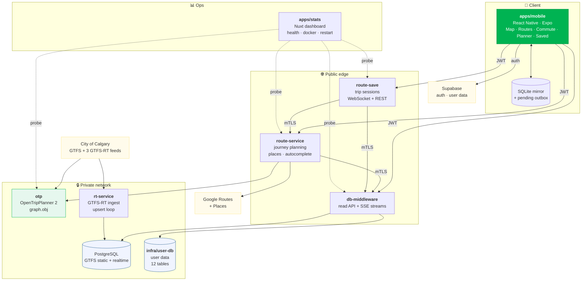
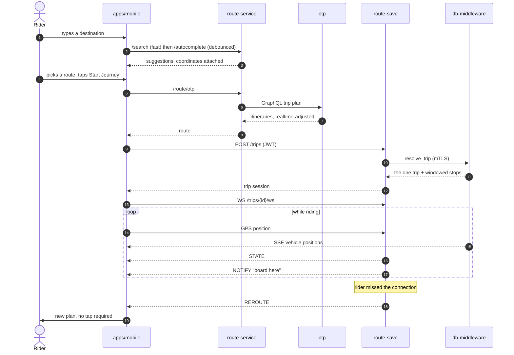

<div align="center">



<br/>

**Plan a Calgary transit trip, start it, and get told when to leave — on data that is seconds old.**<br/>
<sub>A React Native app, five Go services, and a self-hosted OpenTripPlanner graph. Journey planning, live vehicle positions over SSE, a WebSocket trip session that reroutes when you miss the bus, and a day planner that works out when to walk out the door.</sub>

<br/><br/>


<br/>


<a href="LICENSE"></a>

<br/><br/>

**[What it is](#-what-it-is) · [Architecture](#-how-it-fits-together) · [The monorepo](#-the-monorepo) · [Each service](#-what-each-piece-does) · [A journey, end to end](#-a-journey-end-to-end) · [Security](#-how-the-services-trust-each-other) · [Run it](#-run-it-yourself) · [Credits](#-credits)**

</div>


## ✦ What it is

Calgary Transit publishes a static GTFS schedule and three GTFS-Realtime feeds. Google Maps will route you across them. Neither will tell you *"leave in four minutes or you miss the 3"*.

Tranzit is the rest of that: a transit app that holds a **trip session** on the server while you ride it, watches the realtime feed under your route, and pushes you a notification when the arithmetic between where you are and when the bus comes stops working.

It is built as **seven deployable pieces**, each with its own build, its own container and its own history — now in one repository.

- 🗺️ **Plan a journey** against a self-hosted OpenTripPlanner graph, with Google Routes as the fallback.
- 🚍 **Watch the fleet move** — live vehicle positions streamed over SSE, diffed incrementally so the map never rebuilds.
- 🎒 **Start a journey** and hand it to a server-side session: GPS tracking, boarding confirmation, automatic rerouting, iOS Live Activities and Android sticky notifications.
- 📅 **Plan a whole day** on a 24-hour timeline. Each event gets a pre-computed arrive-by route, a faded travel-time lead-in, and a *leave now* notification timed off real transit data.
- 📴 **Work offline** — a SQLite mirror with a pending-write outbox fronts every user table, so saved places and planned trips survive a dead tunnel.

## ✦ How it fits together



Only three services are reachable from the internet. Everything else — the routing graph, the realtime ingest loop, both databases — sits on a private mesh and is never published.

## ✦ The monorepo

Seven projects that used to be seven repositories. **Nothing was merged into a monolith**: each directory keeps its own `go.mod` or `package.json`, its own `Dockerfile`, its own `docker-compose.yml`, and all of its original commits.

```
tranzit/
├── apps/
│   ├── mobile/          React Native (Expo) — the app
│   └── stats/           Nuxt — service health + docker dashboard
├── services/
│   ├── route-service/   Go — journey planning, places, autocomplete
│   ├── route-save/      Go — active trip sessions (WebSocket + REST)
│   ├── db-middleware/   Go — the only public door to the databases
│   ├── rt-service/      Go — GTFS-Realtime ingest and upsert loop
│   └── otp/             OpenTripPlanner 2 — the routing graph
├── infra/
│   └── user-db/         PostgreSQL — user data schema + compose stack
└── docs/
```

## ✦ What each piece does

<table>
<tr><th width="22%">Component</th><th width="12%">Stack</th><th>What it is responsible for</th></tr>

<tr><td valign="top"><b>apps/mobile</b></td><td valign="top">React Native<br/>Expo · TypeScript</td><td valign="top">
Five tabs — <b>Map</b>, <b>Routes</b>, <b>Commute</b>, <b>Planner</b>, <b>Saved</b> — plus a hidden community <b>Report</b> screen.<br/><br/>
The Commute screen is a state machine driven by WebSocket messages (<code>STATE</code>, <code>REROUTE</code>, <code>NOTIFY</code>). Themes are whole struct presets in <code>styles/themes/</code> — colours, type scale, MapLibre paint, polylines and stop circles all switch together, and adding one means dropping in a file that implements <code>AppTheme</code>.
</td></tr>

<tr><td valign="top"><b>services/route-service</b></td><td valign="top">Go 1.23</td><td valign="top">
Journey planning. Prefers the self-hosted OTP graph and falls back to Google Routes. Also fronts place search: a fast <code>/search</code> for businesses and a separate <code>/autocomplete</code> that covers street addresses. The app debounces the two differently — 150&nbsp;ms for the instant one, 600&nbsp;ms for the quota-expensive one — so typing a destination does not burn the Places budget.
</td></tr>

<tr><td valign="top"><b>services/route-save</b></td><td valign="top">Go 1.26</td><td valign="top">
Owns a journey while it is being ridden. Creates a trip session, tracks GPS against the itinerary, confirms boarding, reroutes on a missed connection, and streams state over <code>GET /trips/{id}/ws</code>. The owner is bound at creation from the verified JWT <code>sub</code> — never from a client field — and non-owners get a <code>404</code>, not a <code>403</code>.
</td></tr>

<tr><td valign="top"><b>services/db-middleware</b></td><td valign="top">Go 1.23</td><td valign="top">
The only public door to the data. A whitelisted read API over the transit tables (<code>limit</code>/<code>offset</code>/<code>order_by</code> plus exact-match column filters), an SSE route stream, a user-data CRUD surface, and <code>resolve_trip</code> — which resolves the one trip a rider actually boards for a leg, server-side, instead of making the client pull every candidate trip and filter it.
</td></tr>

<tr><td valign="top"><b>services/rt-service</b></td><td valign="top">Go 1.23</td><td valign="top">
Polls Calgary's three GTFS-Realtime feeds and upserts trip updates, vehicle positions and alerts into PostgreSQL, with a 2-hour retention window on the realtime tables and a sanitize pass that drops malformed rows before they reach a query.
</td></tr>

<tr><td valign="top"><b>services/otp</b></td><td valign="top">OpenTripPlanner 2.6<br/>Java 21</td><td valign="top">
Builds a routing graph from Calgary's static GTFS plus an OpenStreetMap extract clipped to the city bbox, then applies the live GTFS-RT feeds through OTP's realtime updaters — so delays and cancellations change trip plans without a graph rebuild. Rebuilt weekly in CI.
</td></tr>

<tr><td valign="top"><b>apps/stats</b></td><td valign="top">Nuxt 4<br/>Tailwind · Chart.js</td><td valign="top">
Operator dashboard. Probes each service server-side to confirm it is actually <i>serving</i> rather than merely <code>Up</code> — which catches the failure mode where a network sidecar restarts and leaves the app listening in an orphaned namespace, so <code>docker ps</code> is happy and every request still 502s.
</td></tr>

<tr><td valign="top"><b>infra/user-db</b></td><td valign="top">PostgreSQL 17</td><td valign="top">
A 12-table user-data schema — saved places, planned trips, calendar mirror, cached pre-routes — in a container with no route to the internet. Postgres speaks raw TCP, which does not fit an HTTPS tunnel, so this node stays private and db-middleware is the only thing that can reach it.
</td></tr>
</table>

## ✦ A journey, end to end



## ✦ How the services trust each other

Two layers, because the threat is different in each direction.

| Direction | Mechanism | Enforcement |
|---|---|---|
| **Rider → any public service** | Supabase JWT (ES256), verified against the project JWKS — `iss`, `aud=authenticated`, `exp` | Hard-enforced on route-save. Soft-rollout flag (`AUTH_ENFORCE`) on route-service and db-middleware |
| **Service → service** | Mutual TLS with leaf certificates from a shared private CA, over the private mesh | Per-sibling: mTLS when that sibling's `*_MTLS_ADDR` is set, public URL otherwise |
| **Anything → the databases** | No route. Both databases are unpublished; db-middleware is the only reachable surface | Topological — there is no port to attack |

The honest caveat, which is written down in each service's `AUTH.md` rather than discovered later: the public-URL fallback for service-to-service calls carries **no credential at all**. It exists so a service can deploy before its siblings' mTLS listeners do. Flipping `AUTH_ENFORCE=true` without first setting the matching `*_MTLS_ADDR` breaks those calls by design.

## ✦ Run it yourself

> Running this needs your own Supabase project, a MapTiler key, a Google Maps key, and roughly 4&nbsp;GB of RAM free for the OTP graph build. Every service reads its configuration from the environment; no deployment detail is committed anywhere in this repository. See [LICENSE](LICENSE) for what you may do with a local build.

**1 — The routing graph** (slowest step; do it first)

```bash
cd services/otp
cp .env.example .env
./build.sh          # fetch OTP, Calgary GTFS and the Alberta OSM extract, clip, build graph.obj
./run.sh            # serve on :8080
```

**2 — The databases**

```bash
cd infra/user-db
cp .env.example .env            # set POSTGRES_PASSWORD
docker compose up -d
docker exec -i tranzit-user-db psql -U tranzit-user -d tranzit-user \
  -v ON_ERROR_STOP=1 < schema.sql
```

**3 — The services** — each one is independent

```bash
for s in db-middleware rt-service route-service route-save; do
  (cd "services/$s" && cp .env.example .env)   # then fill each in
done
# optional, for service-to-service mTLS:
./services/db-middleware/scripts/gen-mtls-certs.sh
# then, per service:
cd services/db-middleware && docker compose up -d --build
```

**4 — The app**

```bash
cd apps/mobile
bun install
cp .env.example .env.local      # point the three service URLs at your deployment
bunx expo start
```

The app fails fast and names the variable if one is missing, rather than silently fetching from an empty host.

**5 — The dashboard** (optional)

```bash
cd apps/stats && npm install && npm run dev    # localhost:3000
```

Each component also carries its own docs: `AUTH.md` for the auth model, `DOCS.md` for the API surface, and a `README.md` where there is more to say.

## ✦ Built with

[OpenTripPlanner 2](https://www.opentripplanner.org/) · [Expo](https://expo.dev) · [MapLibre](https://maplibre.org) + [MapTiler](https://maptiler.com) · [Supabase](https://supabase.com) · [PostgreSQL](https://postgresql.org) · [Tailscale](https://tailscale.com) · [Nuxt](https://nuxt.com) · [Chart.js](https://chartjs.org) · Go · TypeScript

Transit data © [City of Calgary](https://data.calgary.ca) under its Open Data Licence. Street data © [OpenStreetMap](https://www.openstreetmap.org/copyright) contributors, ODbL. Neither is redistributed here — both are fetched at build time.

## ✦ Credits

Built by [**@xuckless**](https://github.com/xuckless) and [**@Wyden13**](https://github.com/Wyden13) (Wendy Nguyen).

The mobile app is a joint effort; the services and infrastructure are [@xuckless](https://github.com/xuckless)'. Every commit in this repository keeps its original author — `git log --author` will tell you who wrote what.

## ✦ License

Source-available, **showcase only** — see [LICENSE](LICENSE). You may read it, study it, and build it locally to evaluate it. You may not redistribute it, operate it for anyone but yourself, or use it as training data.
